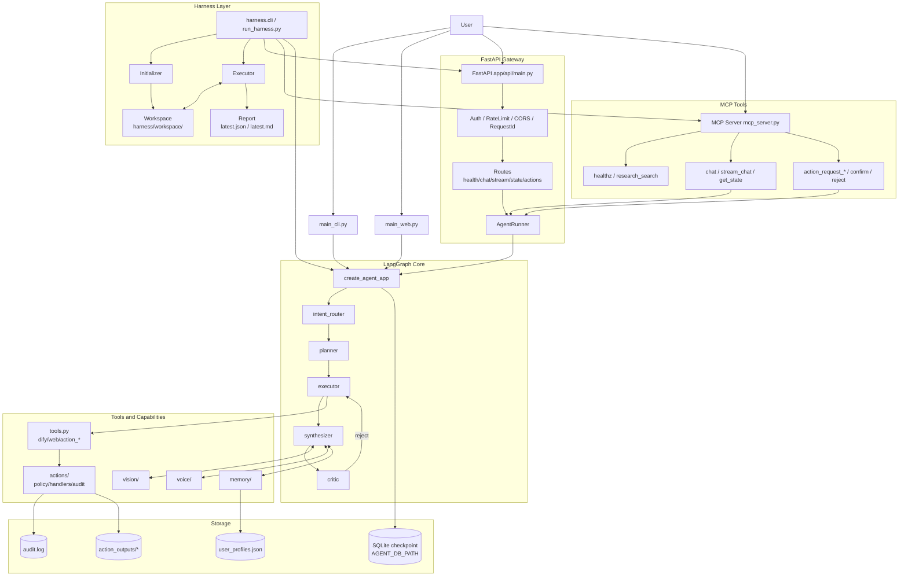
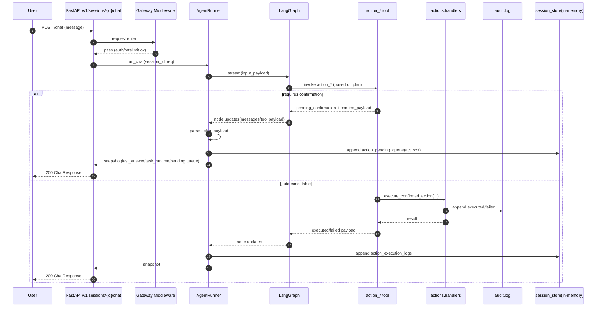
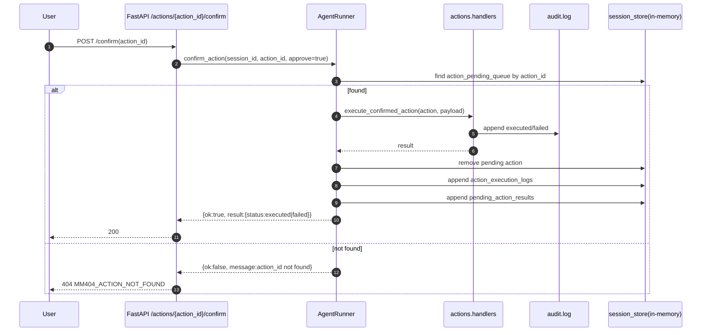
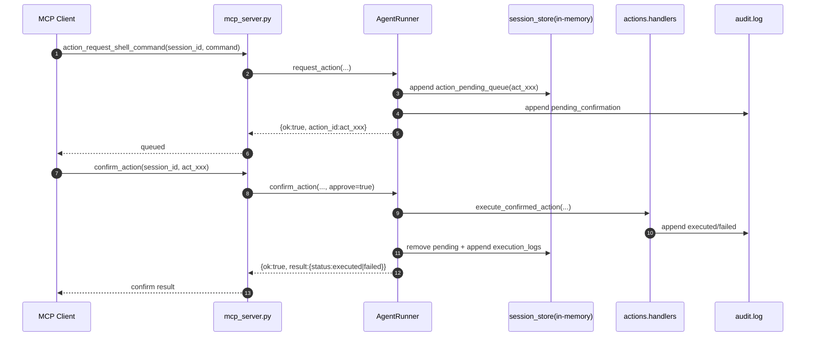

# 项目架构图（总览）



## 部署视角架构图

```mermaid
flowchart LR
    subgraph Client[Client Layer]
      BROWSER[Web Browser]
      CURL[API Client / curl / SDK]
      MCPCLIENT[MCP Client]
      DEV[Developer CLI]
    end

    subgraph AppHost[Application Host]
      subgraph Proc1[Process A]
        STREAMLIT[Streamlit UI<br/>main_web.py]
      end

      subgraph Proc2[Process B]
        FASTAPI[FastAPI + Uvicorn<br/>app/api/main.py]
        GW[Gateway Middleware<br/>Auth / RateLimit / CORS / RequestId]
        ROUTES[Routes<br/>/healthz /readyz /v1/sessions/*]
      end

      subgraph Proc3[Process C]
        MCP[MCP Server<br/>mcp_server.py]
      end

      subgraph Proc4[Process D]
        HARNESS[Harness CLI<br/>harness.cli / run_harness.py]
        HINIT[Initializer]
        HEXEC[Executor]
      end

      subgraph Core[Agent Runtime]
        AR[AgentRunner]
        LG[LangGraph App]
        NODES[intent/planner/executor/synthesizer/critic]
        TOOLS[tools.py<br/>dify/web/action_*]
      end

      subgraph Cap[Capabilities]
        ACTIONS[actions/<br/>policy handlers audit]
        MEMORY[memory/]
        VISION[vision/]
        VOICE[voice/]
      end

      subgraph Persist[Persistence]
        WS[(harness/workspace/<run_id>/*)]
        REP[(harness/report/latest.json|md)]
        DB[(SQLite checkpoint)]
        AUDIT[(audit.log)]
        PROFILE[(user_profiles.json)]
        OUT[(action_outputs/*)]
      end
    end

    BROWSER -->|HTTP| STREAMLIT
    BROWSER -->|HTTP| FASTAPI
    CURL -->|HTTP| FASTAPI
    MCPCLIENT -->|stdio MCP| MCP
    DEV -->|python -m ...| HARNESS

    FASTAPI --> GW --> ROUTES --> AR
    MCP --> AR
    STREAMLIT --> LG
    AR --> LG --> NODES --> TOOLS
    TOOLS --> ACTIONS
    NODES <--> MEMORY
    NODES <--> VISION
    NODES <--> VOICE

    LG --> DB
    ACTIONS --> AUDIT
    ACTIONS --> OUT
    MEMORY --> PROFILE

    HARNESS --> HINIT --> WS
    HARNESS --> HEXEC --> WS
    HEXEC --> REP
    HEXEC -->|entry=api| FASTAPI
    HEXEC -->|entry=mcp| MCP
    HEXEC -->|entry=local| LG
```

## 关键时序图：Chat 到待确认动作



## 关键时序图：Confirm 动作



## 关键时序图：MCP 审批链路


