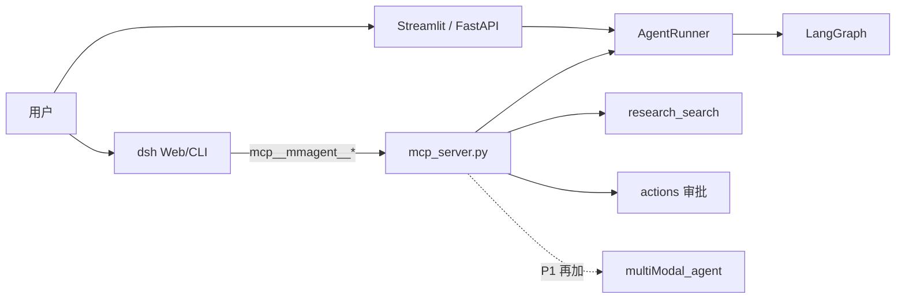

# DeepSeek Harness 混合接入计划

本文记录将 [DeepSeek Harness](https://github.com/deepseek-ai/deepseek-harness)（dsh）以**混合方式**接入本项目的实施方案与引入后的变化。

仓库内的 `harness/` 是本地回归测试框架，与 dsh **不是同一层**。dsh 是 TypeScript Agent 运行时（Cordis，「一切皆插件」）。

**结论：可行，但不要整仓替换。** dsh 当对话与调度层，现有 Python 当领域执行层，中间只用已有 MCP。LangGraph、论文抓取、动作审批第一期不动。

---

## 1. 职责切分

| 层 | 谁负责 | 具体做什么 |
|---|---|---|
| 对话 / 路由 / 会话回放 | **dsh** | 用户说话、选工具、子 Agent、事件日志 |
| 领域能力 | **现有 Python** | 检索、LangGraph 研究回合、动作确认、论文抓取、视觉/语音 |
| 协议 | **MCP** | dsh 用 `@deepseek-ai/dsh-mcp-client` 调 `mcp_server.py` |

不要把 `mcp.tool()` 里的 `chat` / `stream_chat` 暴露给 dsh。那会变成 **dsh loop 再套一层 LangGraph loop**：一次提问走两套模型、两套会话，证据链也对不齐。

第一期只给 dsh 这些工具：

- `healthz` / `research_search`
- `get_state`
- `action_request_*` / `confirm_action` / `reject_action`
- 后续再加 `paper_run`（包装 `agent.multiModal_agent`）

`chat` 留给 FastAPI、Streamlit、CLI。等明确要「复杂研究题仍走 LangGraph」时，再单独加一个 `run_insights_agent`，当**一个**重工具用，而不是默认对话入口。



---

## 2. 落地步骤

### 2.1 本机跑通 dsh，先不改 Python

需要 **Node 22+**。用户配置在 `%USERPROFILE%\.dsh\profiles\web\cordis.patch.yml`（必须用 `insert:`，直接写 `- id:` 会启动失败）。

```yaml
- insert:
    - id: mcp-mmagent
      name: '@deepseek-ai/dsh-mcp-client'
      config:
        serverName: mmagent
        transport: stdio
        command: "D:/A_ZJJ_Project/Multi-Modal AI Insights Agent/multimodal_agent.venv/Scripts/python.exe"
        args: ["mcp_server.py"]
        cwd: "D:/A_ZJJ_Project/Multi-Modal AI Insights Agent"
        toolCallTimeoutMs: 180000
        failOnStartupError: true
        env:
          DEEPSEEK_API_KEY: !!js process.env.DEEPSEEK_API_KEY
```

说明：

- dsh 会**清环境变量再 spawn 子进程**，密钥必须在 `env` 里显式传入。
- 论文/长检索要把 `toolCallTimeoutMs` 提到 10 分钟以上（PDF 下载经常超过默认 60s）。
- 启动后工具名形如：`mcp__mmagent__research_search`、`mcp__mmagent__confirm_action`。

验证：在 dsh 里问「用 MCP 查一下 multimodal VLM」，应打到 `research_search`，而不是 dsh 自带 shell。

### 2.2 收窄 MCP 表面（第一处 Python 改动）

现在 `mcp_server.py` 把 `chat` 和动作、检索绑在同一个 FastMCP 进程里。给 dsh 用时要拆：

- `mcp_server.py`：完整工具（给 Cursor / 本机 `harness/`）
- 新增例如 `mcp_server_dsh.py`：只注册领域工具，**不注册 `chat`/`stream_chat`**

session 约定：dsh 每次调用带同一个 `session_id`（例如 `dsh-<dsh会话id>`），否则 `get_state` / 动作队列会对不上 Python 侧 SQLite checkpoint。

动作仍走现有闭环：`action_request_*` → 待确认 → `confirm_action`。**不要开 dsh 的 Code/Shell 模式去执行同类命令**，否则会绕过 `actions/policy.py`。

### 2.3 把论文子 Agent 做成 MCP 工具（第二处改动）

开机任务 `run_on_startup.bat` 继续直跑 Python。对话里触发分析则加一个短工具，例如 `paper_run(paper_limit, top_k)`，内部调现有 `MultiModalAnalysisAgent.run()`，返回报告路径，而不是把抓取循环搬进 TypeScript。

超时、去重、PDF 落盘逻辑全部留在 `agent/multiModal_agent/`。

### 2.4 可选：MCP 改 HTTP，避免 dsh 每次拉起 Python

当前 `mcp_server.py` 是 **stdio**（`mcp.run()`）。dsh 也能用 `streamable-http`。稳定后可以：

- Python 常驻一个 MCP HTTP（或继续用 FastAPI `:8000`）
- dsh 配置 `transport: streamable-http` + `url`

FastAPI 网关、鉴权、Streamlit **不用删**。dsh 是新客户端，不是替换进程。

---

## 3. 引入 dsh 之后的变化

### 会变

| 点 | 现在 | 引入后 |
|---|---|---|
| 运行时 | 只有 Python | **Python + Node**：dsh 一个进程，MCP/LangGraph 仍是 Python |
| 主对话入口 | Streamlit / FastAPI / CLI | 多一个 **dsh Web/CLI**；Streamlit 可逐步降为面板（视觉、动作审批） |
| 工具调用 | LangGraph `ToolNode` 直接调 `tools.py` | dsh 调 `mcp__mmagent__*`，MCP 再进 `McpService` / `AgentRunner` |
| 会话 | `AGENT_DB_PATH` SQLite checkpoint | **两套会话**：dsh 事件日志 + Python checkpoint，靠 `session_id` 对齐 |
| 配置 | `.env` + `config.py` | 再加 `~/.dsh/profiles/.../cordis.patch.yml` |
| 风险面 | 动作必须确认 | dsh 自带文件/Shell；必须关掉或禁用，否则审批被绕过 |
| 测试 | `harness/` 测 local/api/mcp | 再加一条：**dsh → MCP → 领域工具** 的手工/脚本冒烟 |

### 不变（这才叫混合）

- `graph.py` 的 intent → plan → execute → critic
- `get_data/`、PDF、`arxiv_tracker.json`、开机任务
- FastAPI `/v1/sessions/{id}/chat`、动作 confirm API
- `actions/` 策略与审计
- 仓库里的 Python `harness/`（评测框架，不是 dsh）

### 第一期不要动

- 不要用 dsh 重写 `multiModal_agent`
- 不要替换 Streamlit 的视觉/动作页
- 不要把 critic / `[E#]` 证据规则迁到 TypeScript

用户感知：多一个「能调 Jarvis 工具的 DeepSeek 对话壳」；论文日报、审批、API 行为应与现在一致。

---

## 4. 验收标准

1. dsh 能调 `healthz`、`research_search`，答案来自 Dify/Web，不是模型瞎编。
2. `action_request_write_file` 只进 `action_pending_queue`，确认后才落盘；dsh 自己不能直接写那个文件。
3. Streamlit / FastAPI 原聊天仍可用。
4. `python -m agent.multiModal_agent.run` 与开机任务不受影响。

建议顺序：先做 2.1–2.2（patch.yml + 精简 MCP）验证混合是否值得继续，再做 2.3–2.4。
